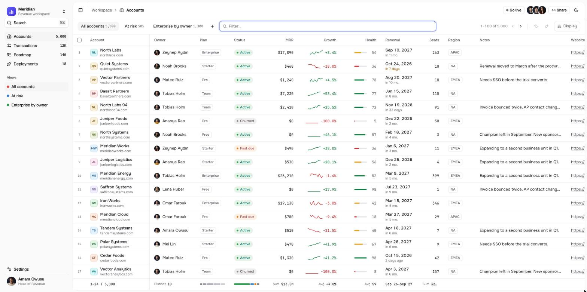

<p align="center">
  
</p>

<h1 align="center">Tally</h1>

<p align="center">The data grid with a query language, saved views and a backend protocol.</p>

<p align="center">
  <a href="https://tally.outhebox.dev/docs">Documentation</a> ·
  <a href="https://play.tally.outhebox.dev">Playground</a> ·
  <a href="https://tally.outhebox.dev">Website</a>
</p>

<p align="center">
  <a href="https://www.npmjs.com/package/tally-react"></a>
  <a href="https://github.com/MohmmedAshraf/tally/actions/workflows/ci.yml"></a>
  <a href="LICENSE"></a>
</p>

## Install

```sh
npm install tally-react tally-core
```

## Quick start

```tsx
import { useState } from 'react'
import { createArraySource, createSchema } from 'tally-core'
import { Tally, useGrid } from 'tally-react'
import 'tally-react/styles.css'

const schema = createSchema({
  key: 'id',
  columns: [
    { id: 'account', label: 'Account', pin: 'left' },
    { id: 'plan', type: 'enum', options: [{ value: 'free' }, { value: 'pro' }, { value: 'team' }] },
    { id: 'mrr', label: 'MRR', type: 'currency', aggregate: 'sum' },
    { id: 'growth', type: 'percent' },
    { id: 'renewal', type: 'date' },
  ],
})

function Accounts({ rows }) {
  const [source] = useState(() => createArraySource(rows, schema))
  const grid = useGrid({ schema, source })
  return <Tally grid={grid} label="Accounts" />
}
```

Then type into the filter bar:

```
status is active and mrr > 2k
renewal last 30 days
sort by mrr desc
group by plan
```

## Features

- **Typed columns.** Fourteen built-in types, each with its own filters, formatting, editor, aggregates and facets. Add your own with the same API.
- **Query language.** `plan is pro or team and renewal next 30 days sort by mrr` parses to a validated AST and runs in memory or on your database, with autocomplete.
- **Views.** Filter, sort, group, column order, pins, density and layout in one serializable object. Save it, put it in the URL, send it to the server.
- **Grouping.** Any column, date buckets from day to year, sums and averages per group and in the footer.
- **Live rows.** Patches re-rank rows in place. Every edit, paste, fill and import is a labeled mutation, so undo reads `Undid Paste 2 cells`.
- **Cards on phones.** Below a breakpoint the grid becomes a card list with a bottom sheet for the full record.
- **One protocol, many backends.** JSON with a published schema and a conformance suite. Node compiles it to SQL through Kysely, Laravel through Eloquent.
- **AI inside the schema.** `ask` turns a sentence into query text and only applies a query that validates. AI columns fill in through live patches.
- **Built for coding agents.** An MCP server that serves every guide and maps a change in plain words to the extension point that owns it.
- **Accessible, international, fast.** WAI-ARIA grid with a live announcer, right-to-left keyboard navigation, locale-aware numbers, smooth at 100,000 rows by 50 columns.

## Backends

Point the grid at a server instead of an array. Every request is validated against `tally-protocol` before any SQL runs.

**Node, any SQL database through Kysely**

```ts
import { createKyselyAdapter, createTallyHandler, postgresDialect } from 'tally-server'

const accounts = createKyselyAdapter({ db, table: 'accounts', schema, dialect: postgresDialect })
const handler = createTallyHandler({ source: accounts, schema, basePath: '/api/accounts' })

app.all('/api/accounts/*', (c) => handler(c.req.raw))
```

**Laravel**

```php
final class AccountsGrid extends Grid
{
    public function query(): Builder
    {
        return Account::query()->whereBelongsTo(auth()->user()->team);
    }

    public function columns(): array
    {
        return [
            ['id' => 'account', 'label' => 'Account'],
            ['id' => 'mrr', 'label' => 'MRR', 'type' => 'currency', 'aggregate' => 'sum'],
        ];
    }
}

Route::tally('/api/accounts', AccountsGrid::class);
```

**Browser**

```ts
import { connectHttpSource } from 'tally-adapters'

const { schema, source } = await connectHttpSource({ url: '/api/accounts' })
const grid = useGrid({ schema, source })
```

`tally-adapters` also wraps TanStack Query, TanStack DB and Supabase, with realtime patches where the backend supports them.

## AI and agents

```ts
import { ask } from 'tally-ai'

const result = await ask('team plans renewing this quarter, biggest first', { model, schema })
```

The model answers in Tally query text, the text is parsed against your schema, and only a query that parses is returned. Any AI SDK language model works.

Give your coding agent the same knowledge:

```sh
claude mcp add tally -- npx tally-mcp-server
```

## Packages

| Package                               | What it is                                                                       |
| ------------------------------------- | -------------------------------------------------------------------------------- |
| [`tally-core`](packages/core)         | Framework-free engine: types, schema, query language, views, executor, mutations |
| [`tally-react`](packages/react)       | The full component plus headless hooks                                           |
| [`tally-vue`](packages/vue)           | Composables over the engine                                                      |
| [`tally-svelte`](packages/svelte)     | Svelte 5 runes and stores over the engine                                        |
| [`tally-solid`](packages/solid)       | Solid primitives over the engine                                                 |
| [`tally-protocol`](packages/protocol) | Wire types, JSON Schema and the conformance suite                                |
| [`tally-server`](packages/server)     | Kysely SQL adapter and Fetch handler with server-sent events                     |
| [`tally/laravel`](packages/php)       | Eloquent adapter, `Route::tally()`, Pest conformance on three databases          |
| [`tally-adapters`](packages/adapters) | HTTP, TanStack Query, TanStack DB and Supabase sources                           |
| [`tally-ai`](packages/ai)             | Natural language to query, AI columns, column design                             |
| [`tally-mcp-server`](packages/mcp)    | MCP server: guides, extension points, query and schema tools                     |

## Extending

- **Renderers and editors** per column type or kind, through props on `<Tally>`.
- **Column types** with their own operators, formatting, aggregates and facets.
- **Labels** for every string in the UI, and a `dir` prop for right-to-left layouts.
- **Intents** to intercept any keyboard or pointer action before the grid handles it.
- **Styling** through CSS variables for every color, spacing and radius, in light and dark.
- **Data sources** by implementing one interface, **SQL dialects** by supplying a few functions.

Ask `tally_where` on the MCP server for the extension point that owns a change.

## Development

```sh
pnpm install
pnpm check
```

See [CONTRIBUTING.md](CONTRIBUTING.md).

## License

[MIT](LICENSE)
